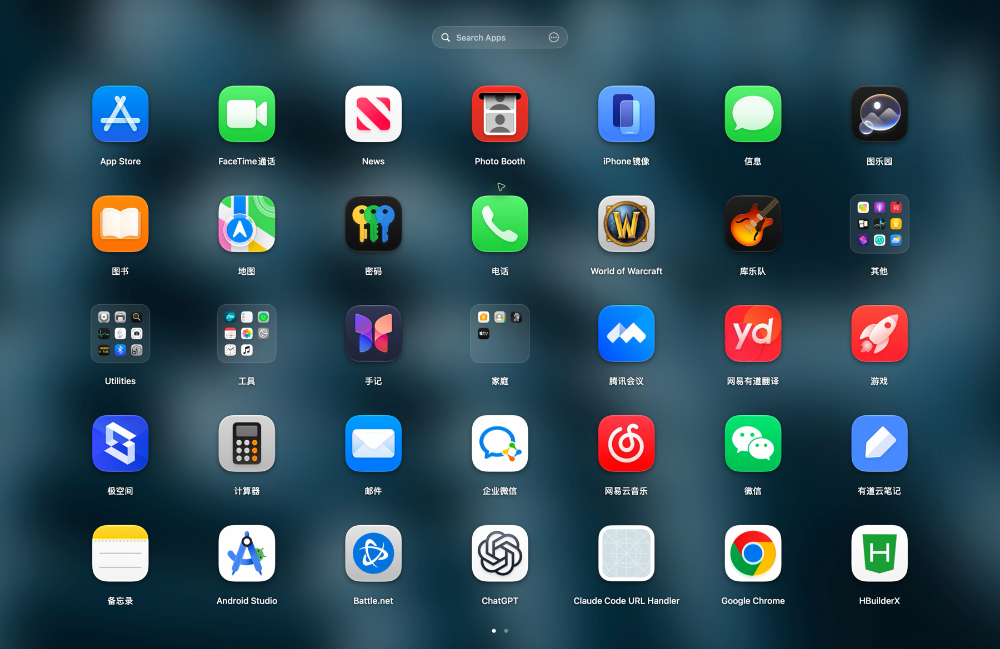
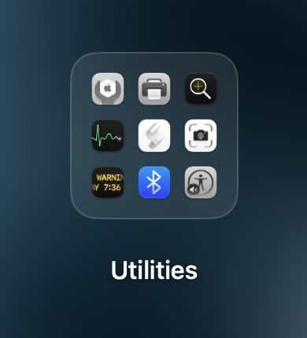
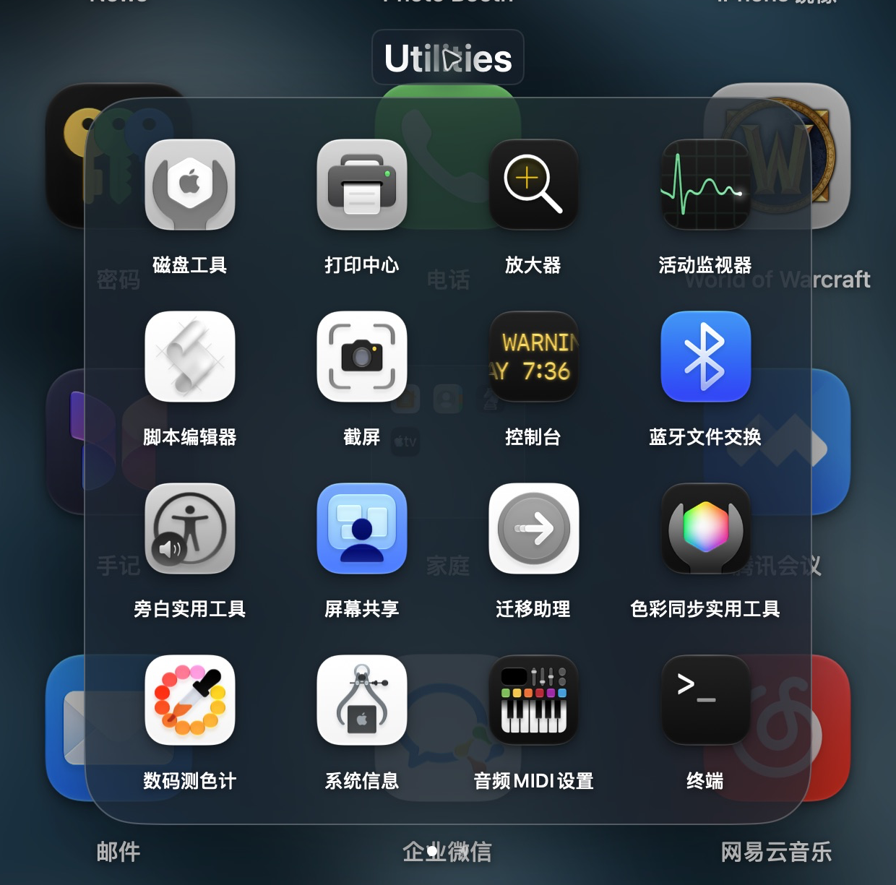
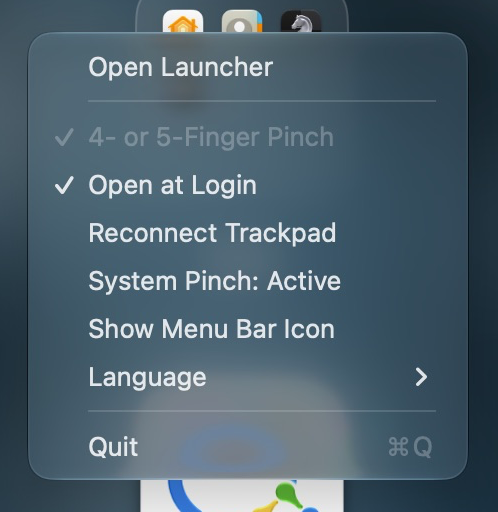
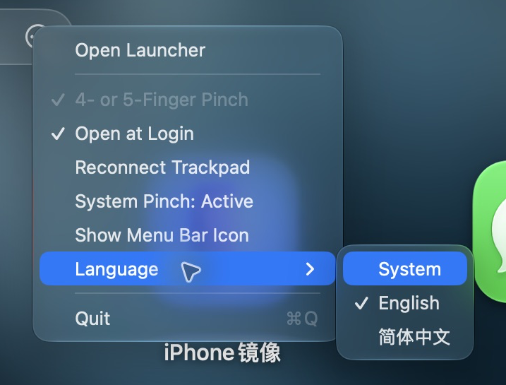
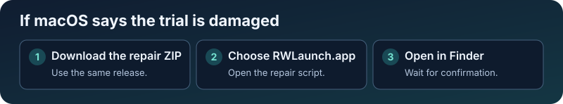

# RWLaunch

[简体中文](docs/README.zh-CN.md) · [Downloads](https://github.com/rockywu/rw-macos-launchapp/releases)

A full-screen app launcher for macOS. Pinch with four or five fingers to open it. Requires macOS 15 or later; works on Apple silicon and Intel Macs.

## Get started

1. Download `RWLaunch-trial.zip` from [Releases](https://github.com/rockywu/rw-macos-launchapp/releases). Unzip it, move `RWLaunch.app` to **Applications**, and open it. Quit any older copy first.
2. Pinch with four or five fingers, or click the grid icon in the menu bar and choose **Open Launcher**.
3. Type to search, or click an app to open it. Press **Esc** to close the grid.

## What you can do

- **Browse:** Swipe sideways with two fingers, use the arrow keys, or click the page dots.
- **Organize:** Drag beside an icon to reorder. Drop onto an app or folder to group items. Press and hold a folder name to rename it.
- **Customize:** Hide the menu bar icon, open at login, or choose English or Simplified Chinese.

## Options menu

Open the menu from the menu bar grid icon or the **…** beside the search field. You can keep both the pinch shortcut and the menu bar icon on. To turn off either one, make sure the other is on.

| Option | What it does |
| --- | --- |
| **Open Launcher** | Opens the app grid. |
| **4- or 5-Finger Pinch** | Enables the pinch shortcut. |
| **Open at Login** | Starts RWLaunch when you sign in. |
| **Reconnect Trackpad** | Reconnects a trackpad if the gesture stops responding. |
| **System Pinch…** | Shows whether RWLaunch can intercept the system pinch. Click to open the relevant permission setting. |
| **Show Menu Bar Icon** | Shows or hides the grid icon. |
| **Language** | Switches immediately. **System** uses Simplified Chinese for Chinese system languages and English for everything else. |
| **Quit** | Stops RWLaunch and its gesture handling. |

## FAQ

**macOS says the app is damaged. What should I do?**

The trial app is ad hoc signed and is not notarized. If macOS says it can’t verify the developer, [try Open Anyway first](https://support.apple.com/en-us/102445). If it says the app is damaged and that option isn’t available, use the repair tool only on the matching copy from this project. If macOS reports malware, don’t proceed.

1. Download and unzip `RWLaunch-repair.zip` from the **same release**.
2. Open `Repair RWLaunch.command` and choose the unzipped `RWLaunch.app`. The tool verifies the app before removing its download quarantine flag. It doesn’t change Gatekeeper settings.
3. On success, reopen the app in Finder. If verification fails, download both ZIPs again. If macOS blocks the script itself, type `/bin/bash` and a space in Terminal, drag the script into the window, then press Return.

**Why does the macOS Apps view still open when I pinch?**

Select **System Pinch…** and allow RWLaunch under **Privacy & Security → Device Control & Data Access** (**Accessibility** on macOS 26 and earlier). If both launchers still open, you can turn off the system **Apps** gesture in Trackpad settings.

**How do I get the menu bar icon back?**

Pinch or reopen RWLaunch from Finder. Open **…** and turn **Show Menu Bar Icon** back on.
