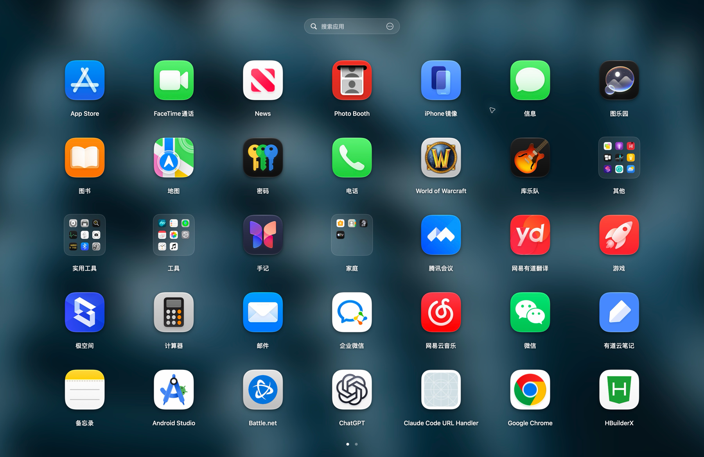
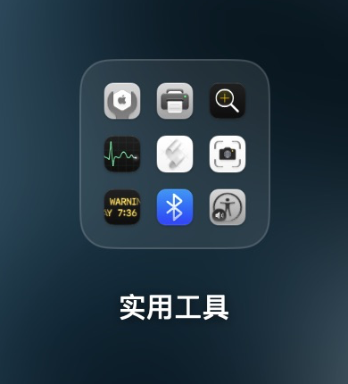
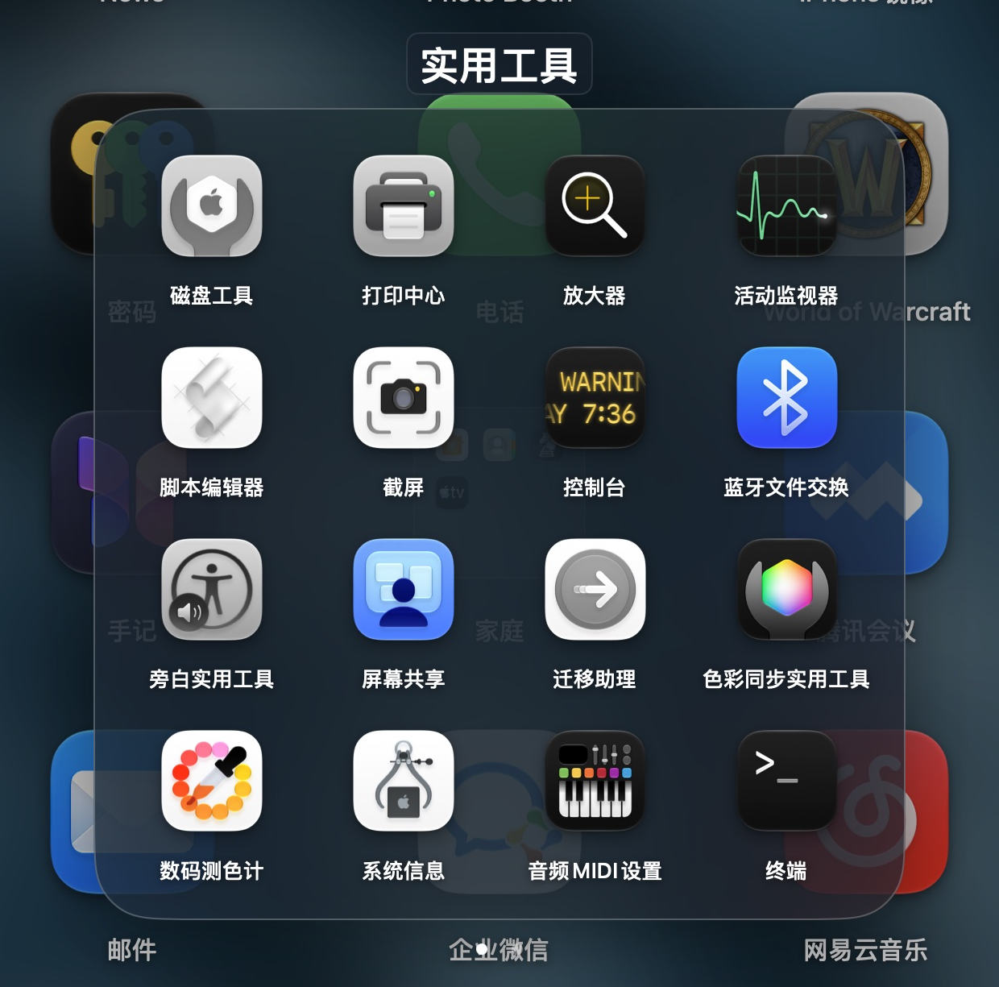
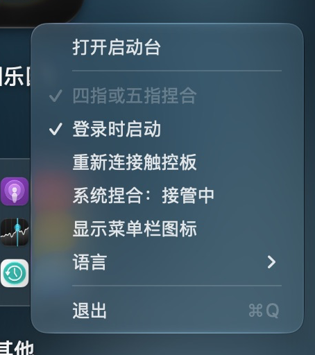
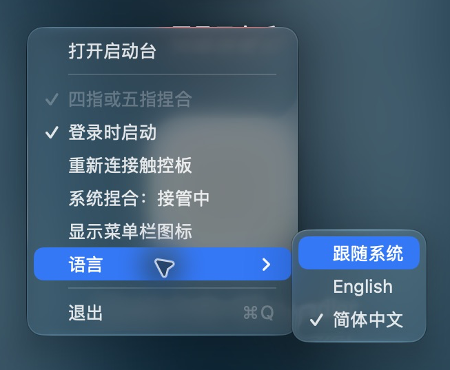

# RWLaunch

[English](../README.md) · [下载](https://github.com/rockywu/rw-macos-launchapp/releases)

macOS 全屏应用启动台。四指或五指向内捏合即可打开。支持 macOS 15 及以上、Apple 芯片和 Intel Mac。

## 安装和使用

1. 从 [发布页](https://github.com/rockywu/rw-macos-launchapp/releases) 下载并解压 `RWLaunch-trial.zip`，将 `RWLaunch.app` 拖进「应用程序」后打开。更新前先退出旧版。
2. 用四指或五指捏合，或点菜单栏九宫格并选择「打开启动台」。
3. 输入名称搜索，点图标打开应用。按 **Esc** 收起启动台。

## 功能清单

- **翻页：** 两指横滑、按左右方向键，或点底部圆点。
- **整理：** 拖到图标旁可排序，拖到图标中央可分组。长按文件夹名称可改名。
- **卸载：** 右键点按应用并选择「卸载…」。核对名称和位置后，点「移到废纸篓」。清倒废纸篓前可将应用放回原处。系统自带的受保护应用不提供此操作。
- **设置：** 可隐藏菜单栏图标、登录时启动，或切换简体中文和英文。

## 菜单说明

点菜单栏九宫格，或点启动台搜索框旁的「…」，都能打开这个菜单。捏合手势和菜单栏图标可以同时开启。要关闭其中一个，请先确认另一个已开启。

| 菜单项 | 作用 |
| --- | --- |
| **打开启动台** | 显示应用网格。 |
| **四指或五指捏合** | 开启或关闭捏合手势。 |
| **登录时启动** | 登录 macOS 后自动运行。 |
| **重新连接触控板** | 手势无响应时，尝试重新连接触控板。 |
| **系统捏合…** | 显示系统捏合的接管状态，点击可打开权限设置。 |
| **显示菜单栏图标** | 显示或隐藏九宫格。 |
| **语言** | 切换即时生效。「跟随系统」在中文系统上用简体中文，其余语言用英文。 |
| **退出** | 停止 RWLaunch 和它的手势处理。 |

## 常见问答

**提示「已损坏」，打不开怎么办？**

试用包使用临时签名，未经 Apple 公证。若系统只提示无法验证开发者，先试 [Apple 的「仍要打开」方法](https://support.apple.com/zh-cn/102445)。若提示「已损坏」且没有该选项，只对从本项目下载的配套试用包使用修复工具。如果系统报告恶意软件，请停止操作。

1. 从**同一个发布版本**下载并解压 `RWLaunch-repair.zip`。
2. 双击 `Repair RWLaunch.command`，选择解压后的 `RWLaunch.app`。工具会先校验应用，再移除该应用的下载隔离标记，不更改 Gatekeeper 设置。
3. 成功后回到访达打开应用。校验失败时重新下载两个 ZIP。若系统拦截脚本，在「终端」输入 `/bin/bash` 和一个空格，把脚本拖进去后按回车。

**为什么捏合时还会打开系统「Apps」？**

点击「系统捏合…」，在「隐私与安全性 → 设备控制和数据访问」（macOS 26 及更早版本为「辅助功能」）允许 RWLaunch。若仍同时出现两个启动台，可在触控板设置中关闭系统的「Apps」手势。

**菜单栏图标隐藏后怎么恢复？**

捏合，或从访达重新打开 RWLaunch。点「…」，重新勾选「显示菜单栏图标」。
